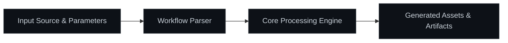

# Project-V1: Creator Workflow & Automation Framework

<div align="center">

[](https://github.com/jeeva4th/Project-V1)
[](https://github.com/jeeva4th/Project-V1)
[](LICENSE)

</div>

## 📌 Overview

**Project-V1** represents the foundational system architecture and scaffolding for creator automation workflows, modular toolsets, and rapid prototyping experiments. Designed to support flexible extension pipelines, modular service integration, and automated production pipelines.

---

## ⚡ Core Features

- **Modular Pipeline Scaffolding:** Clean separation of concerns between core logic, external integration hooks, and runtime assets.
- **Dynamic Asset Ingestion:** Automated handling of multimedia inputs and script components.
- **Workflow State Management:** Resilient tracking of job execution and processing stages.
- **Configurable Toolchain:** Easily adaptable for video generation, content rendering, and data extraction pipelines.

---

## 🛠️ Architecture



---

## 🚀 Getting Started

### Prerequisites
- Python 3.10+ / Node.js 18+
- Git

### Installation
```bash
git clone https://github.com/jeeva4th/Project-V1.git
cd Project-V1
```

---

## 🗺️ Roadmap

- [x] Initial pipeline architecture and repository structure.
- [ ] Integration of automated task schedulers.
- [ ] Connectors to personal AI organization services.

---

## 📄 License

This project is licensed under the MIT License.